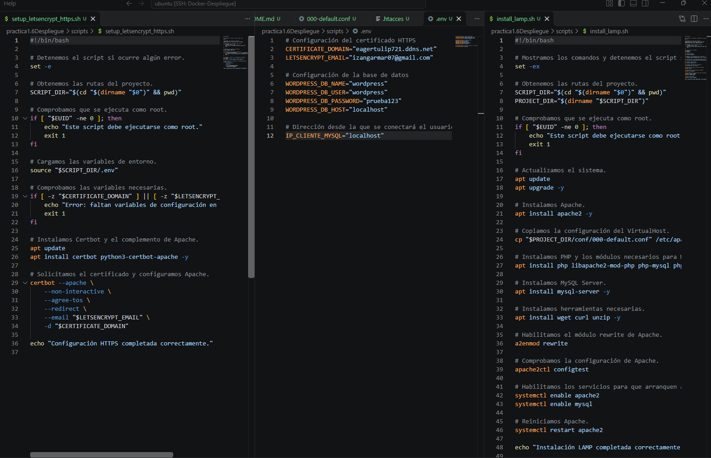
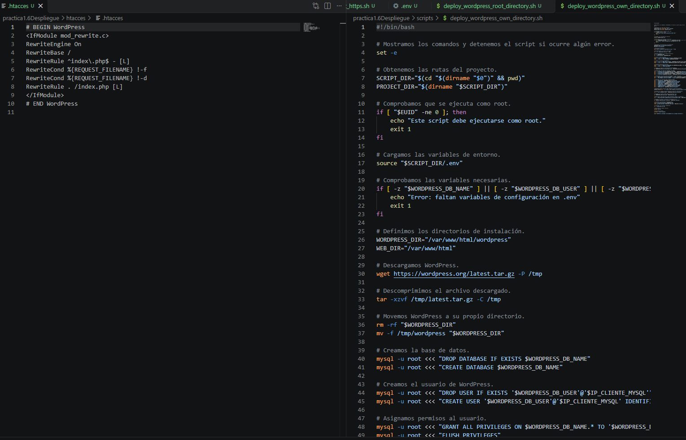
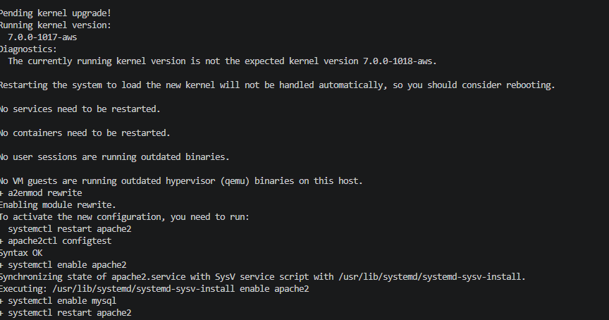
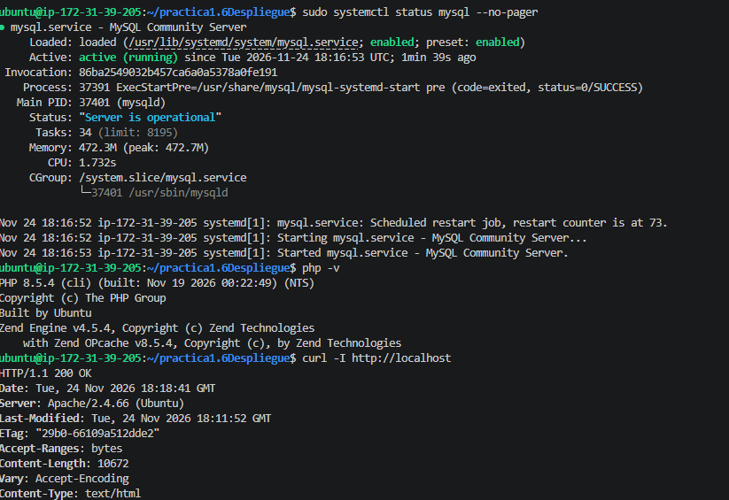
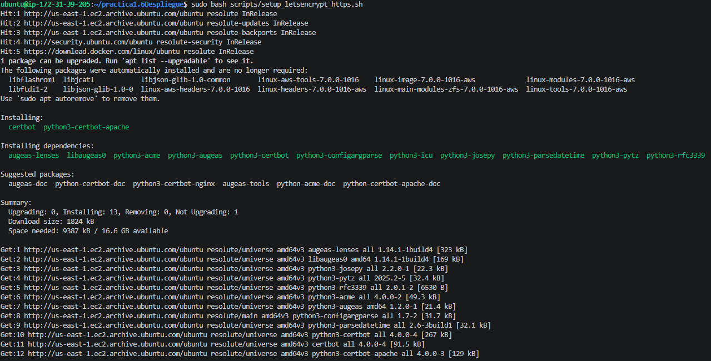
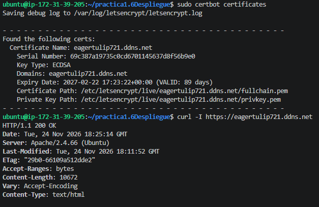
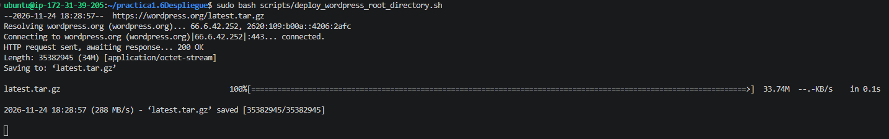
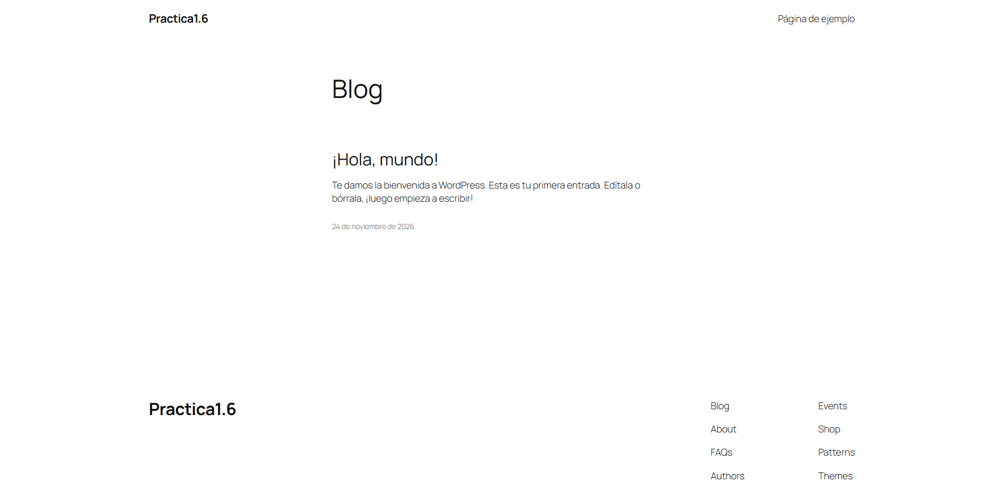

# Práctica 1.6 – Despliegue de WordPress en un servidor web

## Descripción

En esta práctica se ha desplegado un servidor web LAMP en una instancia EC2 de AWS y se ha configurado una conexión segura HTTPS mediante un certificado SSL/TLS de Let's Encrypt.

Posteriormente, se ha instalado y configurado WordPress, utilizando MySQL como sistema gestor de bases de datos y Apache como servidor web.

## Tecnologías utilizadas

- **AWS EC2:** instancia donde se aloja el servidor.
- **Apache:** servidor web.
- **PHP:** lenguaje de programación del servidor.
- **MySQL:** sistema gestor de bases de datos.
- **WordPress:** gestor de contenidos (CMS).
- **Let's Encrypt:** autoridad de certificación para HTTPS.
- **Certbot:** herramienta para obtener y configurar el certificado SSL/TLS.
- **No-IP:** servicio utilizado para obtener un dominio gratuito.
- **Bash:** lenguaje utilizado para automatizar la instalación y configuración mediante scripts.

## Configuración realizada

1. Preparación de los scripts Bash para automatizar el despliegue.
2. Instalación de Apache, PHP y MySQL mediante un script.
3. Configuración del VirtualHost de Apache para utilizar el dominio de No-IP.
4. Comprobación del funcionamiento de los servicios LAMP.
5. Instalación y configuración de Certbot.
6. Obtención e instalación de un certificado SSL/TLS de Let's Encrypt.
7. Configuración de Apache para utilizar HTTPS y redirigir las conexiones HTTP.
8. Creación de una base de datos y un usuario específico para WordPress.
9. Descarga e instalación de WordPress en el directorio raíz `/var/www/html`.
10. Configuración del archivo `wp-config.php`, incluyendo las credenciales de la base de datos y las claves de seguridad.
11. Asignación de permisos adecuados a los archivos y directorios de WordPress.
12. Acceso al asistente de instalación y configuración inicial de WordPress.

## Capturas de pantalla

### Scripts de instalación y configuración

### Configuración de .htaccess y despliegue en directorio propio

### Finalización de la instalación LAMP

### Comprobación de los servicios LAMP

### Ejecución del script de configuración de Let's Encrypt

### Certificado SSL/TLS y conexión HTTPS

### Despliegue de WordPress en el directorio raíz

### Asistente de instalación de WordPress

## Uso de inteligencia artificial

Se ha utilizado inteligencia artificial como herramienta de apoyo durante la realización de la práctica para:

- Revisar y corregir los scripts Bash utilizados.
- Resolver dudas sobre los comandos y la configuración del servidor.
- Recibir orientación paso a paso durante el despliegue.
- Ayudar a identificar y solucionar errores durante la configuración.
- Comprobar el funcionamiento de los servicios y las aplicaciones desplegadas.

La configuración, ejecución de los comandos y comprobaciones se han realizado en la propia instancia EC2.

## Autor

Izan García Martín

2º DAW – IES Celia Viñas